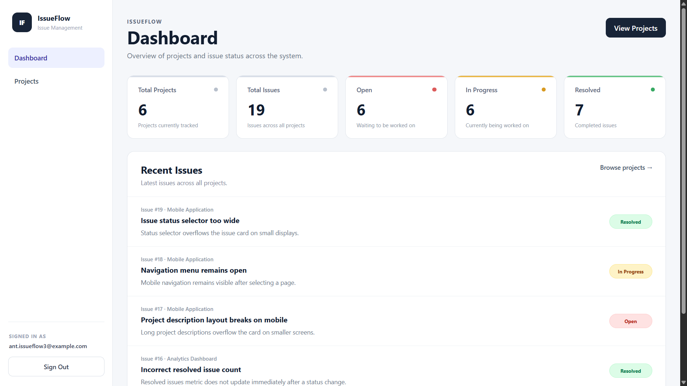
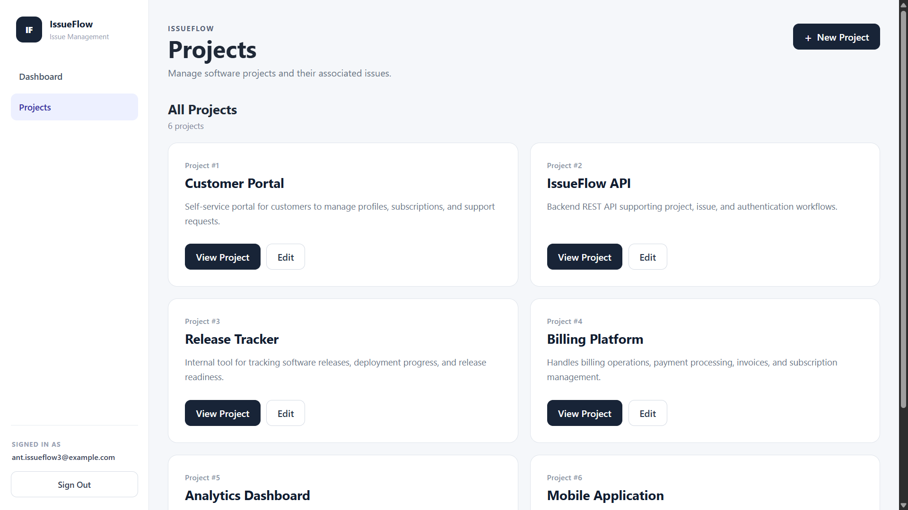
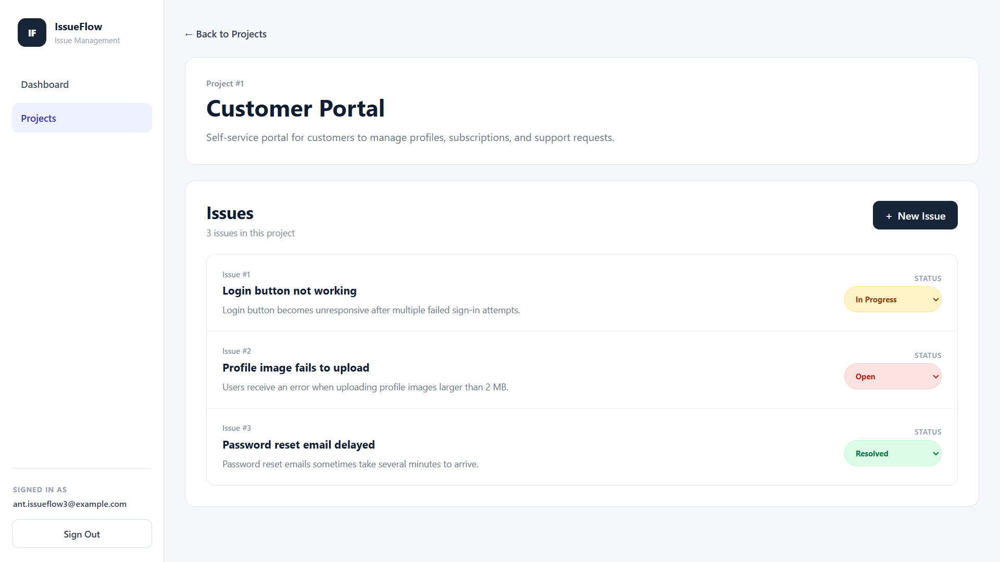
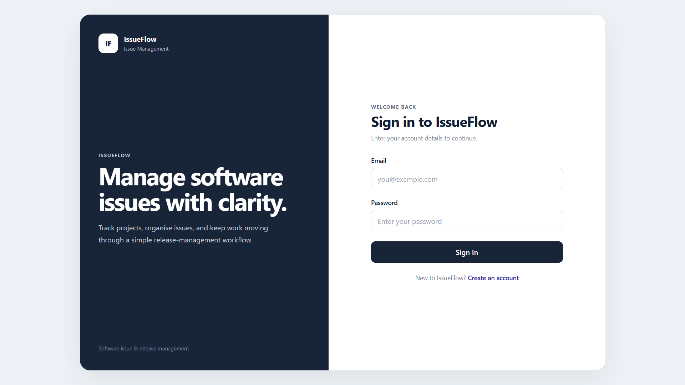
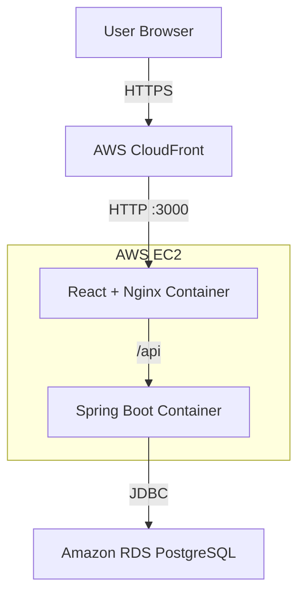
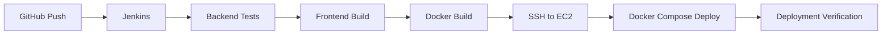

# IssueFlow

IssueFlow is a full-stack software issue and project management application built to demonstrate practical software engineering across backend development, frontend development, automated testing, containerisation, CI/CD, and cloud deployment.

The application provides a focused workflow for managing software projects and tracking issues through **Open**, **In Progress**, and **Resolved** states.

**Live Demo:** [Open IssueFlow](https://dqulob2798ik0.cloudfront.net)

---

## Overview

IssueFlow was developed as a portfolio project inspired by real issue-management workflows.

Rather than focusing only on CRUD functionality, the project was extended through the full software delivery lifecycle: API design, validation, automated testing, responsive frontend development, Docker containerisation, Jenkins CI/CD, AWS deployment, managed PostgreSQL, and production-style deployment verification.

The final application is deployed on AWS and accessible through an HTTPS CloudFront URL.

---

## Application Preview

### Dashboard



### Projects



### Issue Management



### Authentication



---

## Features

### Authentication

- User registration
- User login and logout
- Session-based authentication using `HttpSession`
- Password hashing with BCrypt
- Session restoration through `/api/auth/me`
- Protected frontend routes

### Project Management

- View all projects
- Create new projects
- View individual project details
- Edit existing projects
- Validation for required project fields
- Responsive project cards and empty states

### Issue Management

- View issues belonging to a project
- Create new issues
- Update issue status
- Supported statuses:
  - Open
  - In Progress
  - Resolved
- Responsive issue list
- Status-specific visual indicators

### Dashboard

- Total project count
- Total issue count
- Open issue count
- In-progress issue count
- Resolved issue count
- Recent issues across projects

### User Experience

- Responsive desktop and mobile layouts
- Project and issue creation modals
- Empty states
- Loading and error states
- Form validation feedback
- Mobile navigation
- Consistent status colour system

---

## Tech Stack

| Layer | Technologies |
|---|---|
| Backend | Java 21, Spring Boot 4 |
| API | Spring Web MVC, REST |
| Persistence | Spring Data JPA, Hibernate |
| Database | PostgreSQL |
| Validation | Jakarta Validation |
| Authentication | HttpSession, BCrypt |
| Backend Testing | JUnit, Spring Boot Test, H2 |
| Frontend | React 19, TypeScript |
| Build Tool | Vite |
| Routing | React Router |
| Containerisation | Docker, Docker Compose |
| Web Server | Nginx |
| CI/CD | Jenkins |
| Cloud | AWS EC2, Amazon RDS, CloudFront |
| Source Control | Git, GitHub |

---

## Architecture

```md


The frontend and backend run as Docker containers on an AWS EC2 instance.

Nginx serves the React application and proxies API requests to the Spring Boot backend. The backend connects to PostgreSQL hosted separately on Amazon RDS.

CloudFront provides the public HTTPS endpoint used for the portfolio demo.

---

## CI/CD Pipeline

IssueFlow uses Jenkins to automate testing, building, deployment, and deployment verification.



The Jenkins pipeline performs the following stages:

1. Checkout the latest source code.
2. Run the backend automated test suite.
3. Install frontend dependencies and build the React application.
4. Build backend and frontend Docker images.
5. Connect to the AWS EC2 instance through SSH.
6. Pull the latest repository changes.
7. Build and deploy the AWS Docker Compose configuration.
8. Verify both backend and frontend services before marking the pipeline successful.

A failed test or frontend build prevents later deployment stages from running.

---

## Automated Testing

The backend currently contains **58 automated tests** covering controller behaviour, service logic, authentication, validation, and application context integration.

Tests use an H2 in-memory database configured in PostgreSQL compatibility mode, allowing the Jenkins pipeline to run without requiring an external PostgreSQL instance.

Run the backend test suite with:

```bash
./mvnw test
```

On Windows:

```powershell
.\mvnw.cmd test
```

---

## Local Development

### Option 1 — Docker Compose

The easiest way to run the complete application locally is with Docker Compose.

Create a local `.env` file in the project root:

```env
ISSUEFLOW_DB_PASSWORD=your-local-database-password
```

Then run:

```bash
docker compose up -d --build
```

The services will be available at:

```text
Frontend:   http://localhost:3000
Backend:    http://localhost:8080
PostgreSQL: localhost:5433
```

Stop the application with:

```bash
docker compose down
```

The PostgreSQL data is stored in a Docker named volume and persists between normal container restarts.

---

### Option 2 — Run Backend and Frontend Separately

For backend development, ensure PostgreSQL is available and configure the required database environment variables.

Run the backend:

```powershell
.\mvnw.cmd spring-boot:run
```

The backend starts on:

```text
http://localhost:8080
```

For frontend development:

```bash
cd frontend
npm install
npm run dev
```

Vite will start the development server and display the local URL in the terminal.

---

## Environment Variables

The backend supports environment-based database configuration.

```text
ISSUEFLOW_DB_URL
ISSUEFLOW_DB_USERNAME
ISSUEFLOW_DB_PASSWORD
```

For local Docker Compose, the database URL defaults to the PostgreSQL service running inside the Compose network.

The AWS deployment uses a separate `.env.rds` file stored only on the EC2 instance. Database credentials are not committed to the repository.

---

## AWS Deployment

The AWS deployment uses:

```text
CloudFront
    ↓
EC2
├── React / Nginx
└── Spring Boot
        ↓
Amazon RDS PostgreSQL
```

`compose.aws.yaml` is separate from the local Docker Compose configuration.

The local configuration includes PostgreSQL as a container, while the AWS configuration deploys only the frontend and backend containers because the production database runs on Amazon RDS.

This keeps local development simple while allowing the cloud environment to use a managed database service.

---

## Project Structure

```text
IssueFlow/
├── frontend/
│   ├── src/
│   ├── Dockerfile
│   └── nginx.conf
│
├── src/
│   ├── main/
│   │   └── java/
│   └── test/
│
├── jenkins/
│   └── Dockerfile
│
├── Dockerfile
├── compose.yaml
├── compose.aws.yaml
├── Jenkinsfile
├── pom.xml
├── .env.example
└── README.md
```

---

## Main API Workflows

### Authentication

```text
POST /api/auth/register
POST /api/auth/login
GET  /api/auth/me
POST /api/auth/logout
```

### Projects

```text
GET  /api/projects
GET  /api/projects/{id}
POST /api/projects
PUT  /api/projects/{id}
```

### Issues

```text
GET  /api/projects/{projectId}/issues
POST /api/projects/{projectId}/issues
GET  /api/issues
PUT  /api/issues/{id}/status
```

---

## Development Highlights

IssueFlow was built incrementally, with each stage tested before moving to the next.

The project evolved through:

```text
Backend REST API
        ↓
PostgreSQL persistence
        ↓
Validation and error handling
        ↓
Automated testing
        ↓
React frontend
        ↓
Authentication
        ↓
Docker
        ↓
Jenkins CI/CD
        ↓
AWS EC2
        ↓
Amazon RDS
        ↓
CloudFront
        ↓
Responsive UI/UX polish
```

This approach made it possible to practise not only feature development, but also debugging, deployment, CI/CD, environment configuration, and cloud infrastructure integration.

---

## Scope

IssueFlow is intentionally focused on core software engineering and deployment workflows.

Advanced production security and platform features such as role-based access control, OAuth, Kubernetes, Terraform, multi-region architecture, and advanced observability are outside the current project scope.

---

## Author

Developed by **Anthony Tan Jia Wei**.

GitHub: [Anth0ny835](https://github.com/Anth0ny835)